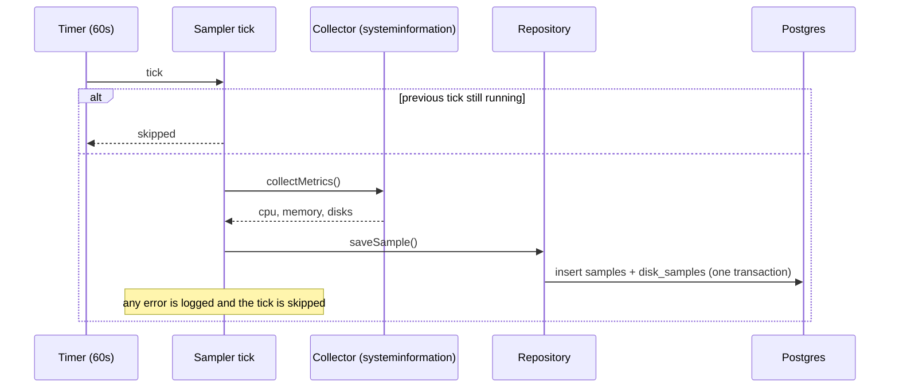
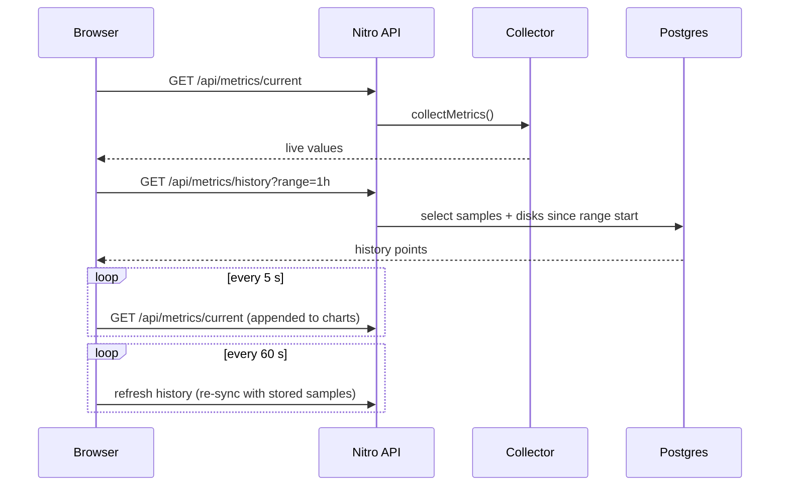

# User manual

## Getting started

1. Start the database: `docker compose up -d`.
2. Create your env file: `cp .env.example .env`.
3. Start the app: `npm run dev`. The log shows `sampler started {"intervalMs":60000}`; the first sample is saved immediately, then one per minute.
4. Open http://localhost:3000.

## Reading the dashboard

1. The top panel shows live CPU, memory and one gauge per disk. Colours turn amber at 70% and red at 90%.
2. Use the **1h / 24h / 7d** buttons to change the history charts.
3. Charts show "Not enough data yet" until at least two samples exist in the selected range (the dashboard has to stay running to collect them).
4. Gauges and charts update automatically every 5 seconds (live points are kept in the browser only; the stored history re-syncs every minute).

## Querying the stored data

```bash
docker exec computer-usage-db psql -U postgres -d computer-usage \
  -c "select ts, cpu_percent, mem_used, mem_total from samples order by ts desc limit 10"
docker exec computer-usage-db psql -U postgres -d computer-usage \
  -c "select s.ts, d.mount, d.used, d.total from disk_samples d join samples s on s.id = d.sample_id order by s.ts desc limit 10"
```

Sizes are bytes; `cpu_percent` is 0–100.

## Troubleshooting

- **No rows appear**: check the dev log for `sample tick failed` or `sampler failed to start` (usually the database is not running or `DATABASE_URL` is wrong).
- **More detail**: set `NUXT_ADD_DEBUG_LOGS=true` and restart.

## Sequence diagrams

Sampling:



Dashboard:


