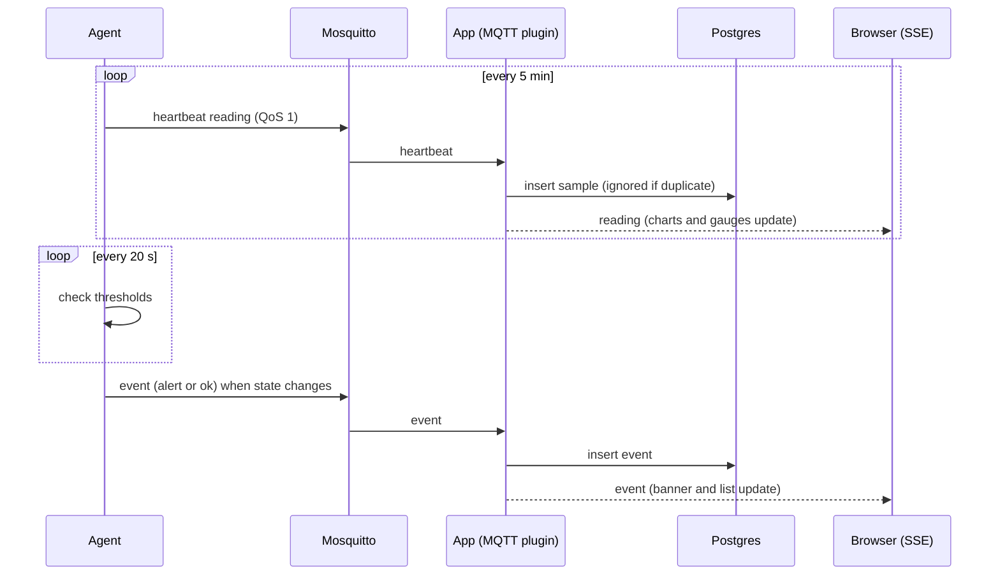
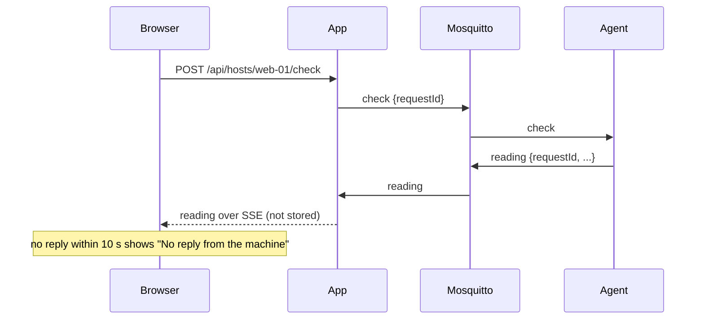

# User manual

## Getting started

1. Create broker users: `docker/mosquitto/add-user.sh app <password>` and `docker/mosquitto/add-user.sh local <password>` (one user per machine; the username is the machine's `HOST_ID`).
2. Start Postgres and the broker: `docker compose up -d`.
3. Create the app env file: `cp .env.example .env` and set `MQTT_PASSWORD` to the `app` password.
4. Start the app: `npm run dev`. The log shows `connected to MQTT broker`.
5. On every machine you want to monitor (including this one), start an agent:

   ```bash
   cd lib/computer-usage-agent
   cp .env.example .env     # set HOST_ID, MQTT_URL (the broker's address) and MQTT_PASSWORD
   npm install && npm start
   ```

   From this repo you can also run `npm run agent`. The agent log shows `connected to broker`.
6. Open http://localhost:3000. The first reading appears as soon as the agent connects (or after clicking **Check now**, if the agent started before the app ever connected).

## Reading the dashboard

1. Use the machine picker to choose a host. The label next to it shows `online`, `offline` (the agent stopped or lost its connection) or `no recent data` (nothing received for twice the heartbeat interval).
2. The top panel shows the host's latest CPU, memory and one gauge per disk. Colours turn amber at 70% and red at 90%.
3. Use the **1h / 24h / 7d** buttons to change the history charts. Each chart has 0/50/100% gridlines (with real sizes for memory and disk) and shows the current reading in its title.
4. Data updates when a heartbeat arrives (every 5 minutes by default), when an alert or recovery event happens, and when you click **Check now**. There is no polling: the page receives updates as they happen.
5. **Check now** asks the selected machine for a fresh reading. It appears within a second or two. Check-now readings are shown but not stored, so the charts keep the 5-minute stored points plus the readings received since the page was opened. If the machine does not answer within 10 seconds you will see "No reply from the machine"; clicking again within 2 seconds shows "Please wait a moment".
6. A red banner lists alerts that are still open (CPU, memory or a disk crossing its threshold). It clears when the agent reports recovery. **Recent events** lists the latest alerts and recoveries.
7. Amber banners mean the app lost the MQTT broker, or the browser lost its live connection (it reconnects by itself and re-syncs).

## Querying the stored data

```bash
docker exec computer-usage-db psql -U postgres -d computer-usage \
  -c "select host_id, ts, cpu_percent, mem_used, mem_total from samples order by ts desc limit 10"
docker exec computer-usage-db psql -U postgres -d computer-usage \
  -c "select host_id, ts, kind, state, value, threshold, mount from events order by ts desc limit 10"
```

Sizes are bytes; `cpu_percent` is 0–100.

## Troubleshooting

- **A machine does not appear, or appears but never shows data**: check the agent log. `connected to broker` means it reached Mosquitto. A connection error with "not authorized" means the user/password is wrong. If the agent connects but nothing arrives, its `MQTT_USERNAME` is probably not its `HOST_ID` (the agent logs an error about this at startup, and a shell variable can override the `.env` file): the broker silently drops what a user publishes outside its own host topic. Check the app log for `mqtt message rejected` (invalid or hostile payloads) or `ingest failed`.
- **The app shows "MQTT disconnected"**: the broker is down or `MQTT_URL`/credentials are wrong; the log shows `mqtt error`.
- **Alerts never fire**: lower the agent's thresholds to test (e.g. `MEMORY_THRESHOLD_PERCENT=1`), restart it and wait up to `CHECK_INTERVAL_MS`. CPU alerts need `CPU_CONSECUTIVE_CHECKS` checks in a row.
- **More detail**: set `NUXT_ADD_DEBUG_LOGS=true` (app and agent) and restart.

## Sequence diagrams

Heartbeat and threshold event:



Check now:


