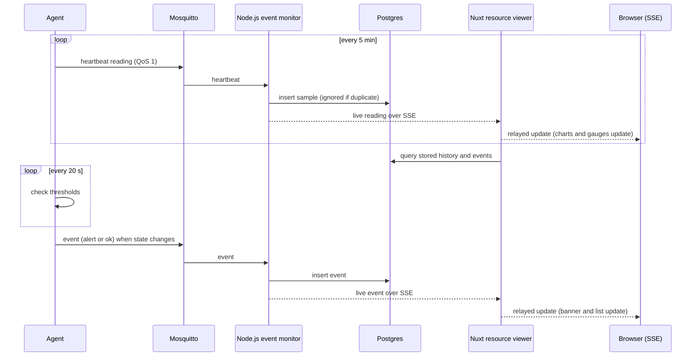
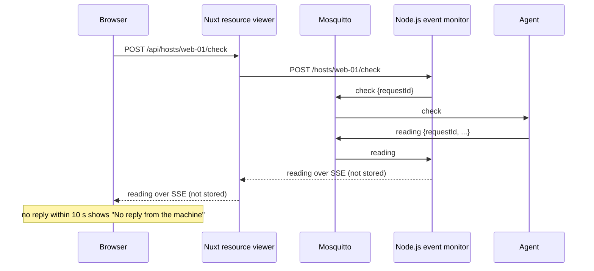

# User manual

## Getting started

1. Create broker users: `docker/mosquitto/add-user.sh app <password>` and `docker/mosquitto/add-user.sh local <password>` (one user per machine; the username is the machine's `HOST_ID`).
2. Start Postgres and the broker: `docker compose up -d`.
3. Create the event-monitor env file: `cp event-monitor/.env.example event-monitor/.env`; set its database URL and MQTT app credentials.
4. Create the dashboard env file: `cp dashboard/.env.example dashboard/.env`; set its database URL and `EVENT_MONITOR_URL` if the monitor is not at its default address.
5. Start the Node.js event monitor with `npm run monitor`. Its log shows the MQTT broker connection and database migrations run automatically at startup.
6. Start the viewer in another terminal with `npm run dev`, then open http://localhost:3000.
7. On every machine you want to monitor (including this one), start the agent:

   ```bash
   cd agent
   cp .env.example .env     # set HOST_ID, MQTT_URL (the broker's address) and MQTT_PASSWORD
   npm install && npm start
   ```

   From the project root you can also run `npm run agent`. The agent log shows `connected to broker`.
8. The first reading appears as soon as the agent connects (or after clicking **Check now**).

## Reading the dashboard

1. Use the machine picker to choose a host. The label next to it shows `online`, `offline` (the agent stopped or lost its connection) or `no recent data` (nothing received for twice the heartbeat interval).
2. The top panel shows the host's latest CPU, memory and one gauge per disk. Colours turn amber at 70% and red at 90%.
3. Use the **1h / 24h / 7d** buttons to change the history charts. Each chart has 0/50/100% gridlines (with real sizes for memory and disk) and shows the current reading in its title.
4. Data updates when a heartbeat arrives (every 5 minutes by default), when an alert or recovery event happens, and when you click **Check now**. There is no polling: the page receives updates as they happen.
5. **Check now** asks the selected machine for a fresh reading. It appears within a second or two. Check-now readings are shown but not stored, so the charts keep the 5-minute stored points plus the readings received since the page was opened. If the machine does not answer within 10 seconds you will see "No reply from the machine"; clicking again within 2 seconds shows "Please wait a moment".
6. A red banner lists alerts that are still open (CPU, memory or a disk crossing its threshold). It clears when the agent reports recovery. **Recent events** lists the latest alerts and recoveries.
7. Amber banners mean the event monitor lost the MQTT broker, or the browser lost its live connection (it reconnects by itself and re-syncs).
8. **Delete server logs** removes all stored samples (including disk readings) and events for the selected machine only. Confirm the prompt to proceed. Its machine entry remains, and future readings are stored as usual.

## Querying the stored data

```bash
docker exec computer-usage-db psql -U postgres -d computer-usage \
  -c "select host_id, ts, cpu_percent, mem_used, mem_total from samples order by ts desc limit 10"
docker exec computer-usage-db psql -U postgres -d computer-usage \
  -c "select host_id, ts, kind, state, value, threshold, mount from events order by ts desc limit 10"
```

Sizes are bytes; `cpu_percent` is 0–100.

## Testing the agent on different servers

`docker-compose.test-servers.yml` starts the agent in six throwaway containers that connect to the project's Mosquitto broker: Debian 12, Ubuntu 24.04, Fedora 41, Alpine 3.20 (musl libc and busybox tools), Debian 12 with Node 24, and one "alert" agent whose disk threshold is 1% so it publishes an event right away. It also starts the event monitor and the dashboard as containers, so the data is saved and charted end to end. See `docker/test-servers/HOW-TO-RUN.md` for the full step-by-step guide.

1. Choose two passwords: `export APP_PASSWORD=... TEST_AGENT_PASSWORD=...` (the broker password of the `app` user and of the `test-*` agents).
2. Run `docker/test-servers/run.sh`. It creates the broker users, builds and starts the containers, listens on the broker for `WAIT_SECONDS` (default 45), checks the database and the dashboard, and prints `ok` or `FAIL` per host.
3. Open <http://localhost:3000> (`DASHBOARD_PORT`) to see the `test-*` hosts and their graphs.
4. `run.sh up`, `run.sh verify` and `run.sh down` run the steps separately. `down` also deletes the `test-*` hosts' data from the database. Use `docker compose -f docker-compose.yml -f docker-compose.test-servers.yml logs agent-alpine` to see one container's logs (debug tracing is on).
5. To run the event monitor and dashboard on your machine with npm instead of in containers, use `docker/test-servers/run-with-monitor.sh`.

A host passes when it reports `online`, publishes a heartbeat with a memory reading and at least one disk, has samples saved in the database and is listed by the dashboard; the alert agent must also have an `alert` event saved.

Each agent container mounts a volume on `/data`: a container's own root filesystem is `overlay`, which the agent ignores on purpose, so without a real mount it would report no disk.

## Troubleshooting

- **A machine does not appear, or appears but never shows data**: check the agent log. `connected to broker` means it reached Mosquitto. A connection error with "not authorized" means the user/password is wrong. If the agent connects but nothing arrives, its `MQTT_USERNAME` is probably not its `HOST_ID` (the agent logs an error about this at startup, and a shell variable can override the `.env` file): the broker silently drops what a user publishes outside its own host topic. Check the event monitor log for `mqtt message rejected` (invalid or hostile payloads) or `ingest failed`.
- **The dashboard says "MQTT disconnected"**: the broker is down or the monitor's `MQTT_URL`/credentials are wrong; the event monitor log shows `mqtt error`.
- **Alerts never fire**: lower the agent's thresholds to test (e.g. `MEMORY_THRESHOLD_PERCENT=1`), restart it and wait up to `CHECK_INTERVAL_MS`. CPU alerts need `CPU_CONSECUTIVE_CHECKS` checks in a row.
- **More detail**: set `NUXT_ADD_DEBUG_LOGS=true` (app and agent) and restart.

## Sequence diagrams

Heartbeat and threshold event:



Check now:


